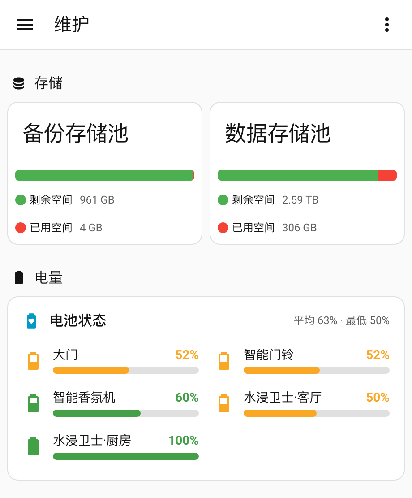
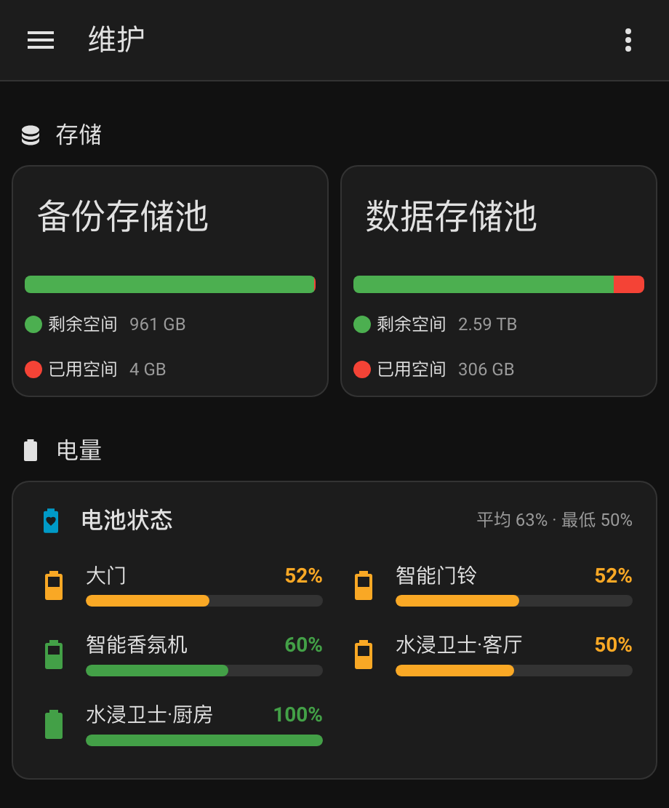
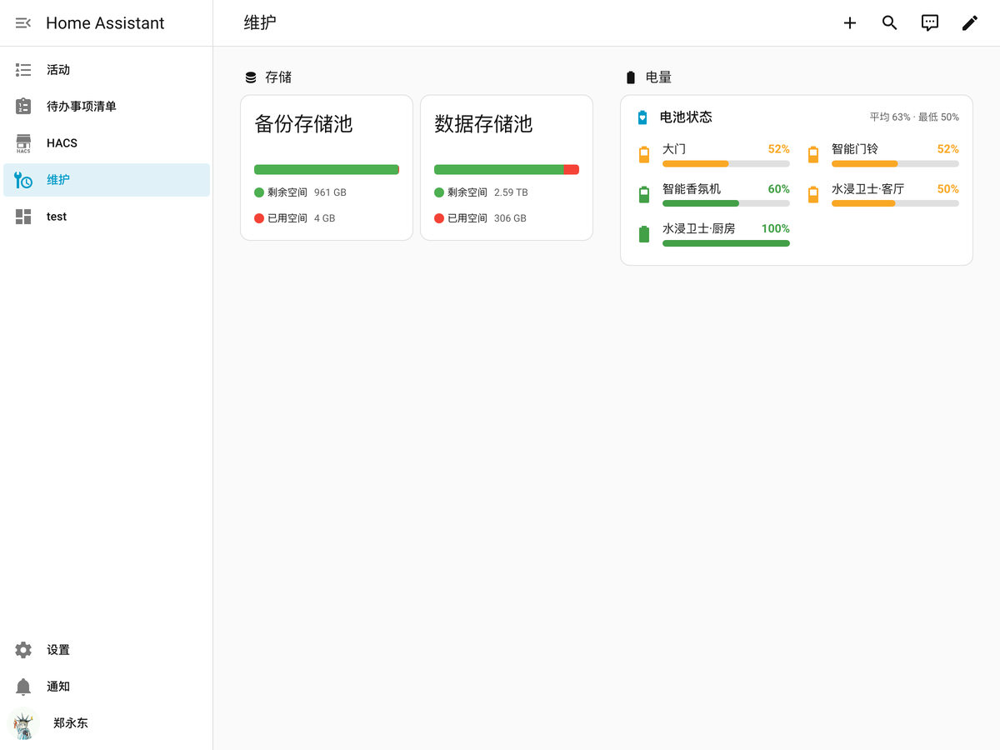
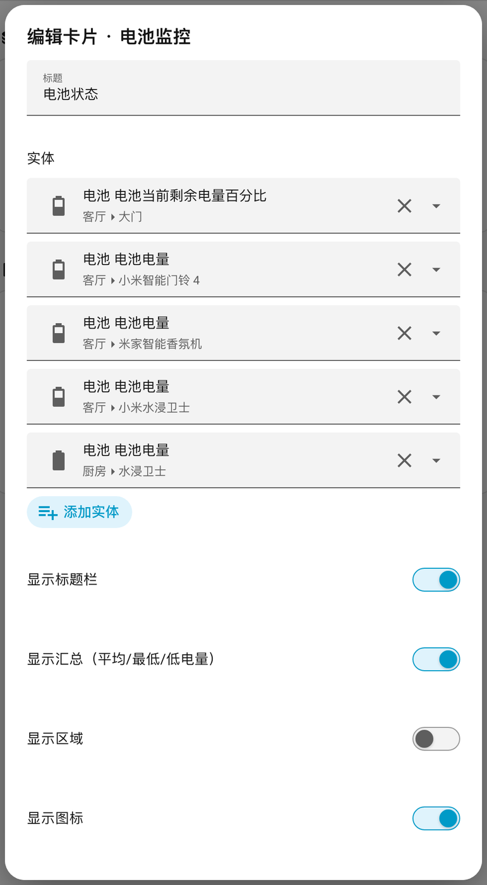

# Battery Monitor Card（电池监控卡片）

一个可配置的 Home Assistant 电池监控卡片：按实体展示**剩余电量百分比**，图标和颜色**随电量档位变化**，并用**进度条**直观显示剩余电量。支持任意数量的电池实体，支持 HACS 安装，也支持通过可视化编辑器配置。

A configurable battery monitor card for Home Assistant. Shows the remaining charge as a percentage, changes the battery icon and color as the level drops, and draws a progress bar for the remaining charge. Works with any number of battery entities, installable through HACS, and configurable from the visual editor.

[](https://github.com/hacs/integration)
[](https://www.home-assistant.io/)
[](LICENSE)

---

## 功能特性

- 🔋 **可配置实体** — 在 YAML 或可视化编辑器中添加任意多个电池实体，支持自定义名称 / 图标 / 固定颜色。
- 📊 **电量百分比** — 每个实体显示剩余电量百分比，自动处理 `unavailable` / `unknown` / 非数字状态。
- 🎨 **图标随电量变化** — 图标自动切换为 `mdi:battery` … `mdi:battery-10`、`mdi:battery-outline`，颜色按阈值档位变化（默认：绿 → 琥珀 → 橙 → 红）。
- 📈 **剩余电量进度条** — 条状进度条 + 数值双重展示，宽度随电量变化，带平滑过渡动画。
- 🧮 **汇总信息** — 标题栏显示平均电量、最低电量以及低电量设备数量。
- 🧱 **布局可调** — 1/2/3 列或自动响应式布局；支持按电量升序 / 降序 / 名称排序；进度条高度、圆角样式可调。
- 🖱️ **交互** — 点击默认打开实体的 more-info 弹窗，支持 `toggle` / `navigate` / `url` 等动作。
- 🌗 **主题适配** — 使用 Home Assistant 主题变量，明暗主题自动适配。
- 🌏 **多语言** — 内置简体中文 / English 文案，跟随 HA 界面语言。
- 🧩 **零依赖** — 单个 `.js` 文件，无需构建步骤。

## 截图

| 亮色主题 | 暗色主题 |
| --- | --- |
|  |  |

| 桌面端（1200px） |
| --- |
|  |



---

## 安装

### 方式一：HACS 自定义仓库（推荐）

1. 打开 **HACS** → 右上角 **⋮** → **自定义存储库 / Custom repositories**。
2. 仓库地址填入 `https://github.com/magiczheng/custom_card`，类型选择 **仪表盘 / Dashboard**，点击 **添加**。
3. 在 HACS 中搜索 **Battery Monitor Card**，点击 **下载**。
4. HACS 会自动注册前端资源；如果没有自动注册，请到 **设置 → 仪表盘 → 资源** 手动添加：
   - URL：`/hacsfiles/custom_card/battery-monitor-card.js`
   - 类型：**JavaScript 模块**
5. 进入仪表盘 → 编辑 → **添加卡片** → 搜索 **电池监控卡片**。

> 如果你之前按「方式二」手动安装过，请在 HACS 安装完成后删除原来的
> `/local/community/custom_card/battery-monitor-card.js` 资源，避免同一模块被加载两次。

> 本仓库不强制依赖 GitHub Release：HACS 自定义仓库在没有 Release 时会使用默认分支（`main`）安装；
> 如果维护者后续发布了带有同名 `battery-monitor-card.js` 资源的 Release，HACS 也可以按 Release 版本安装。

### 方式二：手动安装

1. 下载 [`battery-monitor-card.js`](battery-monitor-card.js)。
2. 复制到 Home Assistant 的 `/config/www/community/custom_card/` 目录（如目录不存在请新建）。
3. 到 **设置 → 仪表盘 → 资源** 添加资源：
   - URL：`/local/community/custom_card/battery-monitor-card.js?v=1.0.0`
   - 类型：**JavaScript 模块**
4. 刷新浏览器（必要时强制刷新），在仪表盘中添加 `custom:battery-monitor-card`。

无需重启 Home Assistant。

---

## 快速开始

```yaml
type: custom:battery-monitor-card
title: 设备电量
entities:
  - sensor.living_room_lock_battery
  - sensor.doorbell_battery
  - sensor.motion_sensor_battery
```

或者直接在「添加卡片」中搜索 **电池监控卡片**，通过可视化编辑器选择实体。

---

## 配置项

| 配置项 | 类型 | 默认值 | 说明 |
| --- | --- | --- | --- |
| `entities` | 列表 | `[]` | **必填**。电池实体列表，元素为实体 ID 字符串或实体配置对象（见下方）。为空时卡片显示引导空态。 |
| `title` | 字符串 | `电池监控` | 标题。 |
| `show_header` | 布尔 | `true` | 是否显示标题栏。 |
| `show_summary` | 布尔 | `true` | 是否在标题栏显示汇总（平均 / 最低 / 低电量数量）。仅在 `show_header: true` 时可见。 |
| `show_area` | 布尔 | `false` | 是否显示实体所属区域。 |
| `show_icon` | 布尔 | `true` | 是否显示电池图标。 |
| `show_name` | 布尔 | `true` | 是否显示名称。 |
| `show_percentage` | 布尔 | `true` | 是否显示百分比数值。 |
| `show_bar` | 布尔 | `true` | 是否显示进度条。 |
| `bar_height` | 数字 | `8` | 进度条高度（px，4–24）。 |
| `rounded` | 布尔 | `true` | 进度条是否为圆角。 |
| `min` | 数字 | `0` | 电量最小值。 |
| `max` | 数字 | `100` | 电量最大值。 |
| `low_battery_level` | 数字 | `20` | 低电量阈值（%），用于汇总中的低电量计数。 |
| `thresholds` | 列表 | 见下 | 颜色档位：`[{ level, color }, …]`，取 `level ≤ 电量` 的最高档颜色。 |
| `sort` | 字符串 | `none` | 排序：`none` / `asc`（电量低→高）/ `desc`（高→低）/ `name`（按名称）。 |
| `columns` | 字符串 | `auto` | 列数：`auto` / `1` / `2` / `3`。 |
| `tap_action` | 动作 | `more-info` | 点击动作。 |
| `hold_action` | 动作 | `none` | 长按动作。 |

### 颜色档位（thresholds）

默认值：

```yaml
thresholds:
  - level: 0
    color: "#e53935"   # 0–9%    红
  - level: 10
    color: "#fb8c00"   # 10–29%  橙
  - level: 30
    color: "#f9a825"   # 30–59%  琥珀
  - level: 60
    color: "#43a047"   # 60–100% 绿
```

图标颜色、百分比颜色和进度条颜色都会使用该档位颜色。电量未知 / 不可用时显示灰色。

### 实体配置对象

```yaml
type: custom:battery-monitor-card
entities:
  - entity: sensor.door_lock_battery
    name: 大门门锁
    icon: mdi:lock-smart
  - entity: sensor.doorbell_battery
    name: 智能门铃
  - entity: sensor.water_leak_battery
    name: 水浸卫士（厨房）
    color: "#42a5f5"   # 忽略 thresholds，固定蓝色
```

| 字段 | 类型 | 说明 |
| --- | --- | --- |
| `entity` | 字符串 | 实体 ID（必填）。 |
| `name` | 字符串 | 自定义显示名称，默认使用实体 `friendly_name`。 |
| `icon` | 字符串 | 自定义图标（如 `mdi:lock`），默认随电量变化。 |
| `color` | 字符串 | 固定颜色（CSS 颜色值），设置后忽略阈值颜色。 |
| `area` | 字符串 | 覆盖显示的区域名称（配合 `show_area: true`）。 |

### 更多示例

**两列 + 按电量从低到高排序：**

```yaml
type: custom:battery-monitor-card
title: 全屋电池
columns: "2"
sort: asc
low_battery_level: 30
entities:
  - sensor.door_lock_battery
  - sensor.doorbell_battery
  - sensor.motion_sensor_battery
  - sensor.water_leak_battery
```

**点击切换 / 自定义动作：**

```yaml
type: custom:battery-monitor-card
tap_action:
  action: more-info
hold_action:
  action: navigate
  navigation_path: /lovelace/battery
entities:
  - sensor.door_lock_battery
```

支持的动作：`more-info`、`toggle`、`navigate`、`url`、`fire-dom-event`、`none`。

> `toggle` 只对可切换的域（如 `light` / `switch` / `fan`）生效；对 `sensor` 等不可切换实体
> 会自动回退为 `more-info`，不会产生服务调用错误。

---

## 实体要求

- 任意实体均可，只要其状态（`state`）是数字或带有 `battery_level` 属性；`device_class: battery` 的传感器最理想。
- 状态为 `unavailable` / `unknown` / 非数字时会显示「不可用 / 未知」，不会报错；排序时这类实体固定排在最后。
- 若实体状态单位不是 `%`（例如电压 `V`），卡片会显示原始数值和单位，进度条按 `min` / `max` 归一化；
  此类实体建议显式设置 `min` / `max`。

---

## 可视化编辑器

卡片内置编辑器：

- 多选实体选择器（可搜索、可添加任意实体）
- 标题、显隐开关、进度条高度、列数、排序、低电量阈值
- 点击 / 长按动作选择

高级选项（`thresholds`、实体级 `name` / `icon` / `color` / `area`）请使用 YAML 编辑。

---

## 常见问题

**Q：卡片提示 “Custom element doesn't exist: battery-monitor-card”。**
A：前端资源未注册或缓存未刷新。请确认资源 URL 正确、类型为「JavaScript 模块」，并强制刷新浏览器（`Ctrl/Cmd + Shift + R`）。

**Q：修改 JS 后没有生效。**
A：修改资源 URL 的版本参数（如 `?v=1.0.1`），或在 HA 中重启前端资源缓存，然后强制刷新。

**Q：实体不显示电量。**
A：确认实体 `state` 是数字（如 `52`）或实体带有 `battery_level` 属性。可在「开发者工具 → 状态」中检查。

**Q：HACS 中找不到卡片。**
A：确认已按上文正确添加自定义仓库，且类型选择为「仪表盘 / Dashboard」；添加后在 HACS 的搜索框中搜索 `Battery Monitor Card`。

---

## 开发

本仓库保持零构建：直接编辑 `battery-monitor-card.js`，无需 `npm install`。

```bash
node --check battery-monitor-card.js

# 可选：本地启动一个静态服务器，把 HA 的 /local 指向仓库目录
python3 -m http.server 8080
```

仓库结构：

```text
custom_card/
├── battery-monitor-card.js   # 卡片源码（HACS 入口文件）
├── hacs.json                 # HACS 仓库声明
├── screenshots/              # README 截图
├── .github/workflows/        # CI 校验
├── CHANGELOG.md
├── LICENSE
└── README.md
```

## 更新日志

见 [CHANGELOG.md](CHANGELOG.md)。

## 许可证

[MIT](LICENSE)
